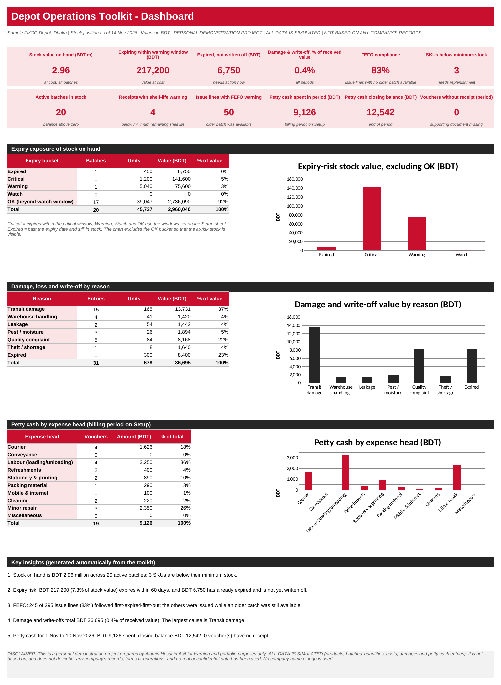
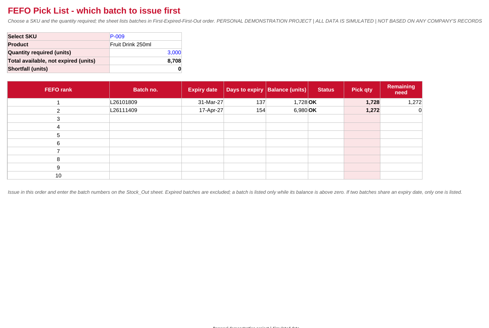

# Depot Operations Toolkit (Simulated Case)

An Excel toolkit for a distribution depot that links four daily records: **goods received, deliveries, damages and petty cash**. It tracks stock **by batch**, ranks batches for **FEFO** (first-expired-first-out) picking, checks every delivery for FEFO compliance, and produces a printable petty cash statement for each billing period.

> **Disclaimer:** This is a personal demonstration project created for learning and portfolio purposes only. **All data is simulated** (products, batches, quantities, costs, damages and petty cash entries). It is not based on, and does not describe, any company's records, forms or operations. No company name or logo is used, and no real or confidential data has been used.

## Business problem

Many depot stock registers track only quantities. Without batch and expiry control:

- older stock is missed and products expire on the shelf,
- the causes of damage and loss stay unclear,
- petty cash accounts take a long time to prepare and check.

This toolkit links the records so that **one entry updates every report**.

## What the toolkit does

| Sheet | Purpose |
|---|---|
| `Setup` | Parameters (report date, expiry windows, petty cash period), SKU master and drop-down lists |
| `Stock_In` | Goods received by batch, with manufacturing and expiry dates and a shelf-life check at receipt |
| `Stock_Out` | Deliveries by challan and batch, with a historical FEFO check |
| `Batch_Stock` | Balance, value, days to expiry, expiry status and FEFO rank for every batch |
| `FEFO_Pick` | Pick list: which batches to issue, in order, for a chosen SKU and quantity |
| `Damage_Register` | Damage, loss and write-off entries with reason, stage and action |
| `Petty_Cash` | Daily cash book with running balance and control flags |
| `PC_Statement` | Printable petty cash statement for a billing period, with signature lines |
| `Stock_Summary` | SKU-level balance, value, minimum-stock status and expiry exposure |
| `Dashboard` | 12 KPIs, expiry exposure, damage by reason, petty cash by head, charts and automatic insights |
| `Guide` | Daily routine, controls, formula logic and interview questions |

## Sample results (simulated data, as of 14 Nov 2026)

| Result | Value |
|---|---|
| Sample depot | 14 products; 47 batch receipts, 295 delivery lines, 31 damage entries, 50 petty cash entries (1 Sep to 14 Nov 2026) |
| Stock value on hand | BDT 2.96 million across 20 active batches |
| Expiring within 60 days | BDT 217,200 (7.3% of stock value) |
| Expired, not written off | BDT 6,750 |
| FEFO compliance | 83% (245 of 295 delivery lines) |
| Damage and write-offs | BDT 36,695 (0.4% of received value); transit damage is the largest cause |
| SKUs below minimum stock | 3 |
| Petty cash, 1 to 10 Nov | BDT 9,126 spent; closing balance BDT 12,542 |

The sample data deliberately includes a few short-dated lots and FEFO slips so that the controls have something to catch.

## Controls built into the toolkit

- **Shelf life at receipt:** (expiry date - receipt date) / (expiry date - manufacturing date). Below 70% is flagged `CHECK`; expired on arrival is `REJECT`.
- **FEFO rank:** rank 1 = the earliest-expiry batch with stock that has not expired. The pick quantity is split across batches in rank order.
- **FEFO check on deliveries:** at each delivery date the sheet adds up older-expiry batches that were still in stock (received, minus earlier issues and damages). If any remain, the line is a `WARNING`. A delivery from an expired batch is an `ERROR`.
- **Duplicate batch check:** each SKU and batch combination must appear once.
- **Petty cash checks:** missing receipts, missing expense heads, courier costs without a valid challan number, and negative balances are flagged.

## How to use

1. Download `Project2_Depot_Operations_Toolkit.xlsx` (GitHub cannot preview Excel formulas) and open the **README** and **Dashboard** sheets first.
2. Explore the sample: try `FEFO_Pick`, filter the `FEFO check` column on `Stock_Out`, and print `PC_Statement`.
3. To test scenarios, change a blue input cell. For example, set the report date on `Setup` to 3 Dec 2026 and watch a batch move to **EXPIRED**.
4. `Project2_Depot_Operations_Toolkit_BLANK_TEMPLATE.xlsx` is the same toolkit without data, ready for your own SKUs and entries.

## Files in this repository

| File | Description |
|---|---|
| `Project2_Depot_Operations_Toolkit.xlsx` | Full toolkit with simulated sample data (12 sheets, about 8,800 live formulas) |
| `Project2_Depot_Operations_Toolkit_BLANK_TEMPLATE.xlsx` | Blank version of the same toolkit |
| `Project2_One_Page_Summary.pdf` | One-page summary of the project |
| `dashboard.png`, `fefo-pick.png` | Screenshots |

## Data

All data is simulated: 14 generic FMCG products in four categories, daily deliveries on working days (Friday closed), random but rule-based damage events, and petty cash entries across ten expense heads. No real names, forms or amounts are used.

## Limitations

- Simulated data, so real-world messiness (missing entries, partial deliveries, late postings) is not included.
- One depot only. No transfers between warehouses, customer returns or splitting of batches.
- A SKU and batch combination must be unique; opening stock is entered as a receipt.
- The FEFO check assumes entries are made in date order.
- Capacity: 200 batches, 500 delivery lines, 150 damage entries, 300 petty cash entries and 30 SKUs (extend by copying the last formula row down).
- A spreadsheet does not replace barcode scanning or an ERP.

## Skills demonstrated

Warehouse and depot operations · batch and expiry control (FEFO) · damage and loss analysis · petty cash control · Excel (SUMIFS, COUNTIFS, INDEX/MATCH, data validation, conditional formatting) · dashboard design · documentation

## Author

**Alamin Hossain Asif** · Dhaka, Bangladesh · Supply chain portfolio, Project 2

LinkedIn: https://www.linkedin.com/in/alamin-hossain-asif
